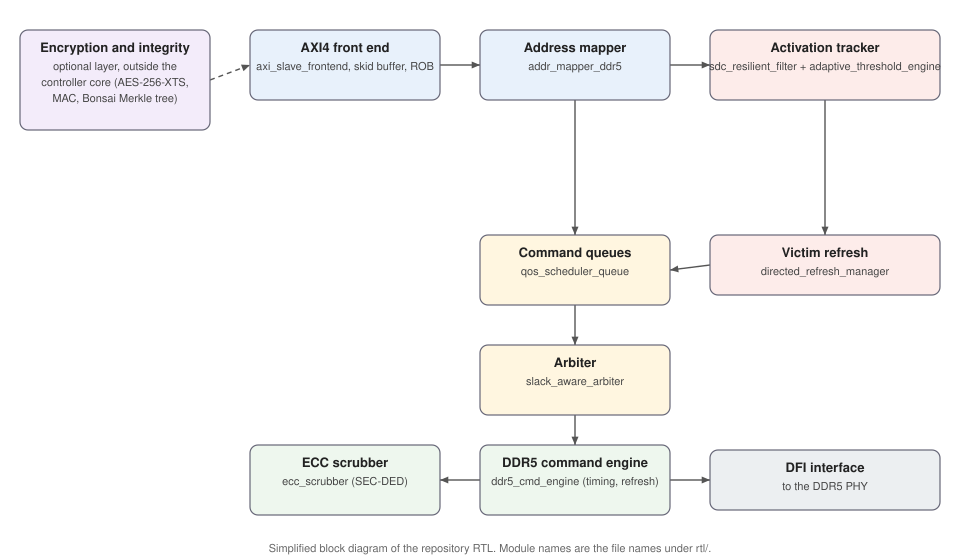
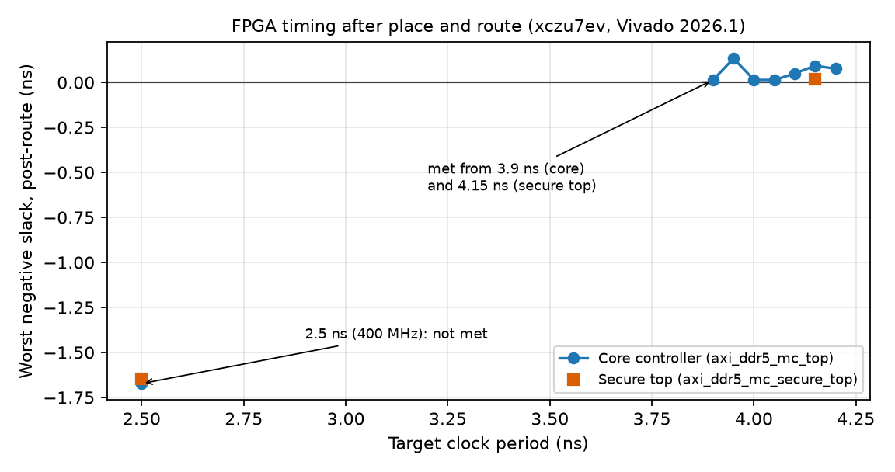

# Q-Shield: A DDR5 Secure Memory Controller (Research Prototype)

[](rtl/frontend/)
[](rtl/)
[](#status-read-this-first)
[](LICENSE)

Q-Shield is a synthesizable SystemVerilog (IEEE 1800-2017) DDR5 memory controller that combines
controller-side RowHammer/RowPress mitigation and error correction with an optional **memory encryption and
integrity layer** (AES-256-XTS, a 64-bit Carter-Wegman MAC, and an 8-ary Bonsai Merkle tree with a trusted metadata
cache) placed outside the controller core. It does not require in-DRAM modifications.



## Status (read this first)

This repository is an **academic research prototype under active verification**. Numbers below are limited to what
has a report or a test log in this repository. Anything not listed as measured is **not yet measured**.

| Area | Status |
| :--- | :--- |
| Functional verification (simulation) | Done for the items listed in [Verification evidence](#verification-evidence). |
| Timing on FPGA (Xilinx `xczu7ev`, Vivado 2026.1) | **Measured. The design does not meet 400 MHz after place and route** (see below). |
| ASIC area, power and timing (Nangate45) | **Not measured yet.** Earlier gate-equivalent and milliwatt figures were removed because no run in this repository produced them. |
| Cycle-accurate performance and RowHammer security evaluation (Ramulator2 + RTL) | **Measured (with caveats).** Commercial-DRAM and non-JEDEC/in-DRAM baselines are evaluated separately in [`reports/paper/perf/perf_report_v2.md`](reports/paper/perf/perf_report_v2.md) and [`reports/paper/perf/perf_report_long.md`](reports/paper/perf/perf_report_long.md) (`33.6 ms >= 1 tREFW`); RTL RowHammer/RowPress matrix (`56/56` cases) is in [`reports/paper/security/security_eval_report.md`](reports/paper/security/security_eval_report.md). Earlier unbacked overhead and zero-disturbance tables were withdrawn. See [`EVALUATION.md`](EVALUATION.md) and [`LIMITATIONS.md`](LIMITATIONS.md). |
| Formal verification | Partial. Bounded model checking (`depth 15`) and cover (`depth 8-15`) for the five suites in [`FORMAL.md`](FORMAL.md); integrity invariants are checked on an abstract model. |

### Measured timing and area (FPGA, out-of-context, `xczu7ev-ffvc1156-2-e`)



The chart plots the slack values in the tables below (core controller sweep and secure top).

Core controller `axi_ddr5_mc_top`, after place and route on post-T86/T88 RTL (reports in [`reports/paper/fpga/t89/`](reports/paper/fpga/t89/) and [`reports/paper/fpga/t92/`](reports/paper/fpga/t92/)):

| Target period | WNS | TNS (failing / total endpoints) | CLB LUTs | CLB registers | BRAM / DSP |
| :--- | :---: | :---: | :---: | :---: | :---: |
| 2.500 ns (400 MHz, T89) | **-1.673 ns** | -40,375.344 ns (70,632 / 107,881) | 64,147 | 44,574 | 0 / 0 |
| 4.200 ns (238.10 MHz, T89) | **+0.076 ns** | 0.000 ns (0 / 107,895) | 62,623 (27.18 %) | 44,581 | 0 / 0 |
| 3.900 ns (256.41 MHz, T92) | **+0.014 ns** | 0.000 ns (0 / 107,704) | 62,699 (27.21 %) | 44,485 | 0 / 0 |

The confirmed post-route clock for the current core RTL is **256.41 MHz** (`3.900 ns`, **confirmed upper bound; periods below 3.900 ns have not yet been swept**), not 400 MHz. Vivado's vectorless power estimate at `3.900 ns` (`256.41 MHz`) is `1.645 W` (`1.048 W` dynamic, `0.597 W` static; [`core_3900ps_route_power.rpt`](reports/paper/fpga/t92/core_3900ps_route_power.rpt)), and `1.572 W` (`0.975 W` dynamic, `0.597 W` static) at `4.200 ns` (`238.10 MHz`), which are rough estimates and not measurements.

Secure top `axi_ddr5_mc_secure_top` (core + encryption and integrity layer), place and route on `xczu7ev` on post-T86/T88 RTL ([`reports/paper/fpga/t89/`](reports/paper/fpga/t89/)):

| Target period | WNS | TNS (failing / total endpoints) | CLB LUTs | CLB registers | BRAM |
|---|---|---|---|---|---|
| 2.500 ns (400 MHz, T89) | -1.648 ns | -81,083.195 ns (132,736 / 244,412) | 167,139 | 110,454 | 7.5 |
| 4.150 ns (240.96 MHz, T89) | **+0.018 ns** | 0.000 ns (0 / 244,317) | 165,776 (71.95 %) | 110,405 | 7.5 |

The highest clock that closed timing for the secure top is **240.96 MHz** (`4.150 ns`). An earlier pre-T86/T88 run at `4.100 ns` (`243.90 MHz`) missed by `-0.005 ns` (`3 / 243,659` failing endpoints; [`sec_confirmed_route_timing.rpt`](syn/reports/evidence/sec_confirmed_route_timing.rpt)), bracketing the secure top around `4.150 ns`. Vivado's vectorless power estimate at `4.150 ns` is `4.301 W` (`3.689 W` dynamic, `0.612 W` static; rough estimate, not a measurement). Reports:
[`fpga_ppa_summary.md` (T89)](reports/paper/fpga/t89/fpga_ppa_summary.md), [`fpga_ppa_summary.md` (T92)](reports/paper/fpga/t92/fpga_ppa_summary.md),
[`2.5 ns core timing`](reports/paper/fpga/t89/core_2500ps_route_timing.rpt), [`3.9 ns core timing`](reports/paper/fpga/t92/core_3900ps_route_timing.rpt),
[`2.5 ns secure timing`](reports/paper/fpga/t89/sec_2500ps_route_timing.rpt), [`4.15 ns secure timing`](reports/paper/fpga/t89/sec_confirmed_route_timing.rpt),
[`4.15 ns secure power`](reports/paper/fpga/t89/sec_confirmed_route_power.rpt).

Metadata cache `qshield_meta_cache` alone: synthesis WNS is `+0.037 ns` at `2.500 ns`
([`meta_cache_synth_timing.rpt`](syn/reports/evidence/meta_cache_synth_timing.rpt)).

> Synthesis-only slack is optimistic: for the current core RTL at `2.500 ns`, out-of-context synthesis reported `-0.508 ns`
> while the routed result was `-1.673 ns` (and `-0.022 ns` vs `-1.273 ns` on pre-T86/T88 RTL). Use post-route numbers when comparing.

## Verification evidence

All counts below come from testbenches and evaluation scripts in this repository; run commands are in [`REPRODUCIBILITY.md`](REPRODUCIBILITY.md).

| What | Result |
| :--- | :--- |
| Integrity and encryption layer, end to end (`tb_secure_top_integrity`) | 279 checks (`FAST` mode) / 405 checks (full mode), 0 failures. Covers random traffic, data/MAC/counter/tree-node bit flips, splicing, full replay and data+MAC replay, minor-counter overflow re-encryption, root flush against a Python reference, cache pressure, integrity-off mode, and 1:1 AXI metadata transaction accounting (`meta_rd_cnt=83`, `meta_wr_cnt=131`). |
| AES-256-XTS (IEEE Std 1619) | 2,048 known-answer vectors checked against the RTL. |
| Metadata cache and Merkle engine | 50,000 random cache operations and at least 20,000 engine operations compared with a Python model. |
| Core and secure-top testbenches | `tb_axi_ddr5_mc_top` 19 checks; `tb_axi_ddr5_mc_secure_top` 15 checks; 0 failures. |
| Known-defect reproduction suite (`tb/findings`) | 15 checks; open demo defects (`4/4`) are reproduced and fixed main-path defects/guards pass. |
| Python UVM-style environment (`tb/uvm`, pyuvm 5.0.0) | 23/23 checks over the controller and CSR environments with independent Python golden models. Coverage is measured on bins defined in the environment; it is not code coverage. |
| Corner-case matrix | 26 documented corner cases, each mapped to a testbench. `tools/check_corner_matrix.py` confirms that the testbench exists and, when a run log is available, that it passed. On a fresh checkout without logs it only confirms existence. |
| Mutation testing | 18 of 20 injected faults detected (90 %) in four blocks (scheduler, reorder buffer, AXI adapter, CSR). The encryption and integrity blocks are **not** covered by mutation testing yet. |
| Formal (SymbiYosys) | Bounded model checking (`depth 15`) and cover (`depth 8-15`, 17 traces) across 5 suites for lock and key-valid rules, scheduler bank timing, AXI4 handshake stability, reorder-buffer beat conservation, and integrity invariants. The integrity invariants are checked on an **abstract model** (`formal/integrity_formal.sv`) that does not instantiate the RTL. |
| RTL RowHammer / RowPress matrix (`tools/run_security_eval.py`) | `56/56` cases (`0` simulation errors, `0` B1 violations within ±R, `0` JEDEC timing violations; single seed per case; [`security_eval_report.md`](reports/paper/security/security_eval_report.md)). Known limits: uncounted mitigation-ACT cascade beyond ±R and known-seed PXOR hash-collision bypass. |
| Ramulator2 DDR5 evaluation (`reports/paper/perf/`) | `2,883` short-window runs ([`perf_report_v2.md`](reports/paper/perf/perf_report_v2.md)) and `321` long-window runs at `33.6 ms >= 1 tREFW` ([`perf_report_long.md`](reports/paper/perf/perf_report_long.md)) with commercial-DRAM (`dram_support=none`) separated from non-JEDEC VRR and in-DRAM schemes. Model cross-validation on 14 synthetic traces ([`crossval_report_v2.md`](reports/paper/crossval/crossval_report_v2.md)) shows ~4–5 % systematic optimism; uncalibrated default parameters are used in the matrix. |

A static check (`tools/check_multidriver.py`) rejects registers driven from more than one process. It was added after
synthesis exposed such a defect that simulation had hidden: a read-path integrity-failure flag was forced to zero in
the synthesized netlist.

## Architecture overview

```
AXI4 slave -> [skid buffer] -> [SCARF address mapper] -> [PXOR SDC filter] / [reorder buffer] / [SEC-DED + scrubber]
                                                   -> [timing-slack aware QoS arbiter + directed refresh]
                                                   -> [JEDEC DDR5 command FSM] -> DFI

Secure top (optional): AXI4 -> [AES-256-XTS + MAC + Bonsai Merkle tree + metadata cache] -> controller core
```

### RTL map

| Component | Source | Notes | Test |
| :--- | :--- | :--- | :--- |
| SDC filter | [`sdc_resilient_filter.sv`](rtl/core/sdc_resilient_filter.sv) | Dual-hash count-min sketch with epoch tags; configure the threshold at most half the RowHammer threshold. | `test_sdc_filter.py`, `tb_security_attacks_vcd` |
| PXOR hash | [`pxor_hash_engine.sv`](rtl/core/pxor_hash_engine.sv) | Parallel XOR reduction for filter bins. | `tb_pxor_sdc_filter` |
| SCARF randomizer | [`scarf_dram_randomizer.sv`](rtl/core/scarf_dram_randomizer.sv) | Row-address Feistel, bijective. | `tb_scarf_randomizer` |
| Key table | [`multi_vm_key_table.sv`](rtl/crypto/multi_vm_key_table.sv) | Per-ASID keys, write-only, secure-privileged writes. | `tb_multi_vm_key_table` |
| Fault-hardened CSR | [`fault_hardened_csr.sv`](rtl/core/fault_hardened_csr.sv) | Triple-redundant registers, 2-of-3 vote, glitch latch. | `tb_fault_hardened_csr` |
| Adaptive threshold | [`adaptive_threshold_engine.sv`](rtl/core/adaptive_threshold_engine.sv) | EWMA, clamped. | `tb_adaptive_threshold_engine` |
| Reorder buffer | [`reorder_buffer_rob.sv`](rtl/core/reorder_buffer_rob.sv) | In-order retire per AXI ID. | `tb_reorder_buffer_rob` |
| QoS queue | [`qos_scheduler_queue.sv`](rtl/core/qos_scheduler_queue.sv) | Same-address dependency masks. | `tb_qos_scheduler_queue` |
| Command engine | [`ddr5_cmd_engine.sv`](rtl/backend/ddr5_cmd_engine.sv) | JEDEC timing FSM, refresh, RFM, victim refresh. | `tb_ddr5_cmd_engine`, JEDEC checker in every top-level TB |
| SEC-DED ECC | [`secded_72_64_pkg.sv`](rtl/backend/secded_72_64_pkg.sv), [`ecc_scrubber.sv`](rtl/backend/ecc_scrubber.sv) | Hamming (72,64), inverted check bits. The scrubber also implements zero-cycle fault masking (ZEM); **ZEM is not connected to the core read path** because it exceeded the timing budget (see [`LIMITATIONS.md`](LIMITATIONS.md)). | `tb_eccfail_zem_scrubber`, `tb_rt03_rd_integrity` |
| Chipkill RS(18,16) | [`rs_chipkill_decoder.sv`](rtl/backend/rs_chipkill_decoder.sv) | Standalone module, **not** wired into the top. | `tb_rs_chipkill_selfcheck` |
| Bus scrambler | [`bus_scrambler.sv`](rtl/memory/bus_scrambler.sv) | Pattern obfuscation, not encryption. | `tb_e2e_scoreboard` |
| Encryption/integrity bridge | [`qshield_axi_crypto_bridge.sv`](rtl/crypto/qshield_axi_crypto_bridge.sv) | AES-256-XTS, MAC, tree and cache around the core. Partial-strobe writes and non-16-byte-aligned bursts are rejected with SLVERR. | `tb_secure_top_integrity` |
| Integrity engines | [`qshield_bmt_engine.sv`](rtl/crypto/qshield_bmt_engine.sv), [`qshield_meta_cache.sv`](rtl/crypto/qshield_meta_cache.sv), [`qshield_mac_unit.sv`](rtl/crypto/qshield_mac_unit.sv), [`qshield_counter_unit.sv`](rtl/crypto/qshield_counter_unit.sv) | Bonsai Merkle tree, trusted cache, MAC, split counters. | `tb_qshield_bmt_engine`, `tb_qshield_meta_cache` |
| Canonical top | [`axi_ddr5_mc_top.sv`](rtl/top/axi_ddr5_mc_top.sv) | Controller core used for verification and synthesis. | `tb_axi_ddr5_mc_top` |
| Secure top | [`axi_ddr5_mc_secure_top.sv`](rtl/top/axi_ddr5_mc_secure_top.sv) | Core plus encryption and integrity layer. | `tb_axi_ddr5_mc_secure_top` |
| Demo top | [`sec_ddr5_controller_top.sv`](rtl/top/sec_ddr5_controller_top.sv) | Early integration demo. Do not use for results. | `tb_sec_ddr5_controller_top` |

## Known limitations (summary)

The full list is in [`LIMITATIONS.md`](LIMITATIONS.md). The most important ones:

- Neither the core nor the secure top reaches 400 MHz after place and route on the target FPGA (`256.41 MHz` confirmed upper bound at `3.900 ns` for the core, not yet swept below `3.900 ns`; `240.96 MHz` at `4.150 ns` for the secure top).
- Side-channel resistance is not claimed. The AES S-box is a lookup table.
- Chipkill is a standalone module and ZEM is not on the core read path.
- Formal results are bounded (`depth 15`), and the integrity invariants are checked on an abstract model, not on the RTL.
- In the current RTL, victim-refresh ACTs issued by `directed_refresh_manager` are not counted back into `u_sdc_filter`, allowing cumulative disturbance beyond blast radius `±R` under sustained hammering (`N_RH=128` long-window runs and direct RTL probes).
- With the 4 KB FPGA-scale metadata cache (`64` entries), pointer-chasing workloads such as `429.mcf` incur `69.19 %` cache miss rate and `4.80x` slowdown at `33.6 ms` when integrity is enabled.
- ASIC (Nangate45) synthesis has not been run yet.
- FIPS 140-3 and Common Criteria are used only as technical reference frameworks (no third-party evaluation or accreditation is claimed); see [`docs/standards_matrix.md`](docs/standards_matrix.md).

## Documentation

| Document | Purpose |
| :--- | :--- |
| [`DESIGN.md`](DESIGN.md) | Microarchitecture and implementation results. |
| [`EVALUATION.md`](EVALUATION.md) | Evaluation protocol, what has been measured, and what is pending. |
| [`METHODOLOGY.md`](METHODOLOGY.md) | Experimental protocol. |
| [`FORMAL.md`](FORMAL.md) | Formal verification setup and status. |
| [`LIMITATIONS.md`](LIMITATIONS.md) | Threat model boundaries and known gaps. |
| [`REPRODUCIBILITY.md`](REPRODUCIBILITY.md) | How to rerun the tests. |
| [`INSTALL.md`](INSTALL.md), [`VERSIONING.md`](VERSIONING.md) | Toolchain and versions. |
| [`docs/standards_matrix.md`](docs/standards_matrix.md), [`docs/finding_cwe_map.md`](docs/finding_cwe_map.md) | Mapping to external standards and weakness classes. |

## Quick start

```bash
# Native (Ubuntu 22.04+ / WSL2), Icarus Verilog and Python 3.13
python3 -m pip install -r requirements.txt
python run_iverilog_regression.py --only tb_axi_ddr5_mc_top
python tools/check_multidriver.py
```

For the full regression and container setup see [`REPRODUCIBILITY.md`](REPRODUCIBILITY.md).

## License

MIT, see [`LICENSE`](LICENSE).
